# AI automation: architecture (Phase A1)

Status: **A1 implemented** (this document describes what shipped and why). Later phases are in
[`AI_AUTOMATION_ROADMAP.md`](AI_AUTOMATION_ROADMAP.md).

JobIntel's AI work is numbered **A1–A8** so it doesn't collide with the original phases 1–9 in `TODO.md`.

## 1. Summary

A1 adds an AI layer **without adding a backend, an API key or a paid service**.

```
You decide what is shared ──► JobIntel writes a file ──► YOU hand it to Claude (your Pro login)
                                                              │
   inbox: review · accept · reject ◄── Zod validation ◄── Claude answers with JSON
        │ (accept only)
        ▼
   existing IndexedDB repositories
```

The one design choice that shapes everything: **a website cannot start a Claude session on its own.**
JobIntel is static files on GitHub Pages, so it holds no credentials and no server. The hand-off to
Claude is therefore a deliberate, visible step that the user performs (§6). Everything on either side of
that step is automated and validated.

## 1a. Automation (A2–A8)

```
browser (open) ──auto-sync──► private repo: context/latest.json, profile/resume.md
                                   │
                    daily Claude routine 08:30 IST (owner's subscription)
                    reads context + public feed, validates its JSON, writes results/<date>.json
                    proposes new job boards on claude/sources-<date> in the public repo
                                   │                                  │
browser ◄──auto-import (Zod)── results/<date>.json        auto-sources.yml verifies + merges
  inbox: notes/follow-ups applied automatically; everything else = one click ("Accept all ready")
```

- **Credential.** A fine-grained token with Contents read/write on the one private repo, pasted once. It lives
  in IndexedDB only, is stripped from backups, and is sent only to `api.github.com`.
- **Guard.** The client checks the repository is private before every sync and refuses otherwise.
- **CSP.** `connect-src 'self' https://api.github.com`; nothing else can be reached.
- **Same contract.** The routine validates with `scripts/validate-ai-result.ts`, which imports the app's own Zod
  schema, and the app validates again on import. Schema v2 is a superset of v1.
- **Efficiency.** One routine run per day; the context is pushed only when it changes and at most every 30 minutes.

## 2. What the existing code gave us (reused as is)

| Need | Reused | Where |
|---|---|---|
| Typed, validated IndexedDB stores | `recordStore(name, schema)` | `src/storage/recordStore.ts` |
| Provider + hook per store, reload on restore/clear | `createRecordContext` | `src/features/shared/recordContext.tsx` |
| Safe, pure changes to a job record | `withStage`, `withRejected`, `withNote`, `withDetails` | `src/domain/jobs/actions.ts` |
| Fit scoring that stays authoritative | `matchJob`, `matchRank`, `targetLevels`, `assessJob` | `src/domain/match`, `src/domain/jobs/feedback.ts` |
| Relationship strength without asserting claims | `relationshipsOf` | `src/domain/referrals/contacts.ts` |
| Versioned migrations | `MIGRATIONS` array, `DB_VERSION`/`SCHEMA_VERSION` | `src/storage/migrations.ts` |
| Encrypted backups with older-version restore | `payloadSchema` with `.default([])` | `src/storage/backup.ts` |
| Dialog, tabs, badges, alerts, empty states, download | UI primitives and CSS tokens | `src/components/ui`, `src/styles` |
| Guarding the public build | `check:dist` | `scripts/check-dist.mjs` |

**Changed in existing code (all additive):** DB v4→v5 (three stores), data schema 4→5, `putAction` on the
job-actions provider, backup payload fields with defaults, a nav item, a route, a dashboard panel, two
`check:dist` rules. The deterministic matching engine, learning, analytics and every existing schema are
untouched.

## 3. Architecture

```mermaid
flowchart LR
  subgraph PUBLIC["Public: GitHub Pages and Actions"]
    COL["collector (Actions)"] --> FEED["public/data/jobs.json<br/>public postings only"]
  end

  subgraph BROWSER["Your browser: IndexedDB (never leaves unless you export)"]
    direction TB
    FEEDIN["1. COLLECT<br/>feed validated by feedSchema"]
    CTX["2. CANDIDATE CONTEXT<br/>profile · pipeline · applications · referrals<br/>allowlist builder + switches"]
    PREVIEW["PREVIEW + CONSENT<br/>exact bytes shown; consent per export<br/>logged as counts only"]
    VALID["4. STRUCTURED RECOMMENDATIONS<br/>Zod · versioned · evidence + confidence"]
    INBOX["5. HUMAN APPROVAL<br/>generated → reviewed → accepted / rejected"]
    REPOS["6. LOCAL PERSISTENCE<br/>jobActions · aiRecommendations · aiBriefings · aiExports"]
    FEEDIN --> CTX --> PREVIEW
    VALID --> INBOX -- "accept only; re-checked against live record" --> REPOS
  end

  subgraph OUTSIDE["Outside JobIntel: you drive it"]
    CLAUDE["3. AI ANALYSIS<br/>Claude on your Pro login<br/>claude.ai chat or claude -p"]
  end

  FEED -- "same-origin GET" --> FEEDIN
  PREVIEW -- "file or clipboard<br/>you hand it over" --> CLAUDE
  CLAUDE -- "JSON answer<br/>paste or file" --> VALID
```



### The six layers

| # | Layer | Implementation | Rule it enforces |
|---|---|---|---|
| 1 | Data collection | existing collector → `jobs.json` → `feedSchema` | Public data only; nothing about the candidate. |
| 2 | Personal candidate context | `domain/ai/context.ts` `buildAiContext` | **Allowlist**: each field is copied by name into a new object. A field added to a record later is not exported until someone adds it here. Pure function. |
| 3 | AI analysis | Claude, outside the app | Not in JobIntel's trust boundary; its output is treated as untrusted input. |
| 4 | Structured recommendations | `domain/ai/schema.ts` (`AI_SCHEMA_VERSION = 1`), `domain/ai/import.ts` | Strict Zod. Evidence required. Per-item validation: one bad item never discards the rest. |
| 5 | Human approval | `domain/ai/lifecycle.ts`, `features/ai/InboxPanel` | Nothing is applied on import. Accept is the only path to a record change. |
| 6 | Local persistence | `storage/aiRepository.ts` + existing `jobActions` | Validated on every read and write; included in encrypted backups; cleared by "Clear data". |

### The contract (schema v1)

One JSON object, `format: "jobintel-ai-result"`, `schemaVersion: 1`, echoing the export's `contextId`:

- `recommendations[]` (max 25): `id` (slug), `kind` (`job-fit` | `next-action` | `follow-up` | `insight`), `title`,
  `summary`, `jobId?`, `priority`, `confidence` (0–1), `evidence[]` (1–8: `source` + `ref?` + `detail`),
  `caveats[]`, `action`.
- `action` is a **whitelist of four reversible operations**, each mapped to an existing helper:
  `shortlist` · `not-interested` (reasons) · `add-note` (appended, labelled "AI suggestion") ·
  `set-follow-up` (date, optional next action). Plus `none`.
  There is deliberately **no** action that submits, sends, edits the profile or deletes.
- `briefing?`: `date`, `headline`, `summary`, up to 7 ordered `priorities` (each with evidence and confidence),
  `watchouts[]`.
- Grounding rule, enforced in code: if *every* evidence item is `external` (outside knowledge), confidence is
  capped at 0.5.
- The JSON Schema for the model is generated from the same Zod schema (`z.toJSONSchema`) and embedded in the
  export, so the contract has one source of truth.

Unknown schema versions are refused with a clear message. A future v2 will be added alongside v1, not by loosening it.

### Review lifecycle

```
generated ──► reviewed ──► accepted   (terminal)
    │             │
    └─────────────┴──────► rejected ──► reviewed   (reconsider)
```

Shown on every card as a text label plus a dot (never colour alone), with counts in the inbox header.
Accepting runs `planApply`, which **re-reads the live record**: a recommendation made last week cannot overwrite a
decision made since. If it no longer fits, the card says why and only Reject remains.

## 4. Privacy boundaries

| Data | Lives | Crosses a boundary when | Control |
|---|---|---|---|
| Profile, decisions, notes, leads, messages | Browser IndexedDB | Never, except (a) the user exports an AI context, or (b) an encrypted backup | Switches + preview + per-export consent; backups are AES-256-GCM |
| Public job postings | GitHub repo / Pages | Always public | `feedSchema` |
| AI context file | Downloaded/clipboard on the user's machine | The user gives it to Claude | Exact-bytes preview; consent resets after each export and on any change |
| Export log (`aiExports`) | IndexedDB | Backups only | Counts and switches only; a test asserts no candidate string can appear |
| AI answer | Imported into IndexedDB | Backups only | Validated; text rendered by React (no HTML injection) |

**Default-off (sensitive):** name, current/past employers, schools; compensation and notice period; private
notes/feedback; lead names. **Never exported, whatever the switches:** message bodies and drafts, lead profile and
source links, lead notes and mutual-introducer details, resume label, any file, any backup.

**Public-site guards:**
- No API key or AI endpoint exists in the bundle. `check:dist` fails on `api.anthropic.com`, `api.openai.com`,
  `generativelanguage.googleapis.com` and on Anthropic/GitHub key patterns.
- `check:dist` fails if AI store names or the context/result format names appear in public `data/*.json`.
- The CSP is unchanged (`connect-src 'self'`): the page *cannot* call an AI service even by mistake. E2E fails on any
  request leaving the origin during the whole AI flow.

**What the user is told at the point of decision:** the file is processed by Anthropic under their Claude account's
settings once they hand it over; JobIntel never contacts Claude and holds no key.

## 5. Threat model for AI output

| Threat | Mitigation | Test |
|---|---|---|
| Prompt injection in a job description tries to make the model emit a harmful action | Action whitelist; no send/submit/delete exists; human accepts each; instructions tell the model to ignore posting text | `import.test.ts` "only allows the whitelisted actions" |
| Hallucinated job/company | `jobId` checked against local data; unknown ids are flagged in the import preview and cannot be applied | `reviewImport`, `planApply` tests |
| Stale advice overwrites newer decisions | Re-validation against the live record at accept time | `apply.test.ts`, UI "stale" test |
| Malformed / oversized / non-JSON output | Size cap, fence/prose extraction, strict envelope, per-item validation, specific messages; never throws | `import.test.ts` (30+ cases) |
| Over-confident ungrounded claims | Evidence required; external-only evidence capped at 0.5 | schema tests |
| Prototype pollution via keys | Strict schemas reject unknown keys | `import.test.ts` |
| Re-importing resets decisions | Ids are `${contextId}:${id}`; existing ids are skipped | UI + `reviewImport` tests |
| Tampered backup with AI records | Zod validation before anything is replaced | `backup.ai.test.ts` |

## 6. Integration options, limits and cost

Researched 2026-11-03 from Anthropic's documentation (links at the end). Anything not confirmed is marked.

| Option | What it is | Verdict for JobIntel |
|---|---|---|
| **Manual hand-off** (A1) | You attach the file in a claude.ai chat, or pipe it to `claude -p` signed in with your subscription | **Shipped.** No credentials in the app, no extra cost, full control. |
| **Claude Code Routines** (docs now call them *scheduled tasks*) | Saved prompt + GitHub repos + connectors, run on Anthropic's cloud on a schedule, API call or GitHub event; pushes to `claude/` branches; Pro and above; **research preview** | Cannot see your browser's IndexedDB. Useful only for work on **public** data (discovery, A4) or on data you deliberately place in a **private** repo (A3). |
| **Subscription token** (`claude setup-token`, `CLAUDE_CODE_OAUTH_TOKEN`) | One-year token for scripts/CI; model requests only | Documented for CI/scripts. **Whether unattended use of a personal subscription token is permitted under Anthropic's terms was not verified.** Gate for A2/A3: read the terms first. |
| **Claude API** | Separate Console billing; **a Pro plan does not include it** | Not used. Needs your explicit approval (constraint 6). |
| **Connectors (Gmail/Calendar/Drive)** | Available to claude.ai and to cloud tasks; **not** available to a `setup-token` session | Relevant to A7; see roadmap. |

Subscription-cost implications:
- A1 adds **no cost**. Each analysis uses your existing Pro allowance, shared with all other Claude use. The preview
  shows bytes and approximate tokens so you can keep context small (default: 10 best-fit jobs).
- Routines/scheduled tasks draw from the same subscription pool and are rate-limited. The docs disagree (one says
  hourly caps — about 100 runs/hour/account and 30/hour/task; the launch post says daily caps of 5/15/25 for
  Pro/Max/Team) and the feature is a research preview, so check *claude.ai/settings/usage* before relying on it.
- If `ANTHROPIC_API_KEY` is set in the shell, Claude Code uses it instead of the subscription and **bills API usage**.
  The export screen warns about this.

## 7. Where I departed from the brief's assumptions

1. **No "Routine" in Phase 1.** A routine runs in the cloud against a GitHub repo. The data worth analysing lives
   only in your browser, and this repo is public. Putting it anywhere a routine can reach would break the
   local-first model. The honest A1 is a manual hand-off; routines come in only where the data is public (A4) or you
   opt in to a private repo (A3).
2. **Discovery of ATS boards mostly doesn't need AI.** Probing Greenhouse/Lever/Ashby slugs is deterministic and the
   collector already does it. AI should judge *relevance*, not find URLs (A4).
3. **A consent log and context ids** were added (not in the brief). They make the data hand-off auditable and let an
   import recognise "this answers the export I made".
4. **Partial import, not all-or-nothing.** Models often get one item of twelve wrong. The user sees exactly which
   were rejected and why before anything is added.
5. **Recommendations may not be free-form.** The action whitelist is the main safety property; later phases add
   actions by version bump, each with its own tests.

## 8. Smallest viable implementation (what A1 includes and excludes)

Included: context export, previewed and consented; schema v1; Zod import with partial acceptance; inbox with
four visible states; briefing view; apply via existing helpers; backup/restore/clear integration; guards and tests.

Excluded on purpose: any network call to Claude; scheduling; resume handling; email access; adding referral leads
from AI; auto-ranking changes; editing the profile from AI output.

## 9. Test map

| Area | Files |
|---|---|
| Data privacy (sentinel strings, defaults, never-exported fields, determinism) | `domain/ai/context.test.ts` |
| Schema validation and malformed/hostile output | `domain/ai/import.test.ts` |
| Apply rules and stale-record refusal | `domain/ai/apply.test.ts` |
| Lifecycle and ordering | `domain/ai/lifecycle.test.ts` |
| Repositories, v4→v5 migration with data preserved | `storage/aiRepository.test.ts` |
| Backup compatibility (schemas 1–4 restore; tampering rejected; newer refused) | `storage/backup.ai.test.ts` |
| Consent gating, preview = download, inbox flow, briefing | `features/ai/AssistantPage.test.tsx` |
| Full flow in the built site, no external requests, axe, restore | `e2e/ai.spec.ts`, `e2e/workflow.spec.ts` |

## Sources

- Claude Code scheduled tasks / routines: <https://code.claude.com/docs/en/routines>
- Routines launch post: <https://claude.com/blog/introducing-routines-in-claude-code>
- Routine API trigger and limits: <https://platform.claude.com/docs/en/api/claude-code/routines-fire>
- Authentication and `setup-token`: <https://code.claude.com/docs/en/authentication>
- Using Claude Code with Pro/Max, and API billing: <https://support.claude.com/en/articles/11145838-use-claude-code-with-your-pro-or-max-plan>
