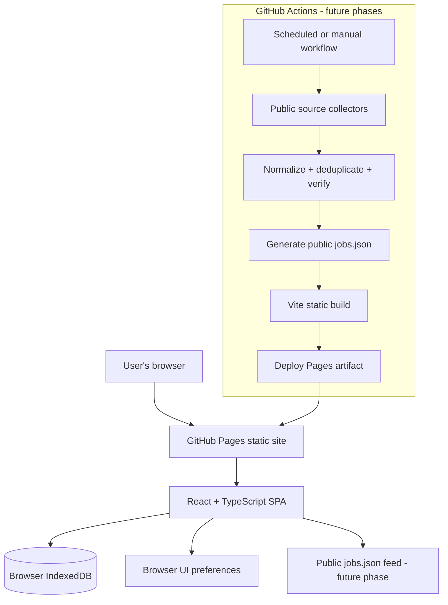

# JobIntel — Product, UX & Implementation Plan

> **Document status:** Implementation brief for Claude Code  
> **Product version:** v0.1  
> **Current delivery scope:** All phases (1–9) are now implemented; see `TODO.md`. The Phase-1-only wording below is kept as the original brief.  
> **Hosting constraint:** The application must be deployable to **GitHub Pages** without requiring a separately hosted backend.

---

## 1. Product vision

JobIntel is a personal job-search intelligence workspace. It should help one candidate discover relevant software engineering openings, understand role fit, identify potential referral contacts, prepare thoughtful outreach, track applications, and improve their job-search strategy over time.

The product should optimize for **relevant interviews secured**, not the number of job listings collected.

### Core product principles

1. **Evidence over guesses:** Every job and referral lead must have a traceable source. Never invent a vacancy, contact, relationship, salary, or posting date.
2. **Local-first personal data:** Candidate details and private job-search activity stay in the user's browser. Do not publish them to GitHub or expose them in static JSON.
3. **Static-hosting-first:** The production application must run as a static frontend on GitHub Pages. No always-on Node/.NET/Python backend is assumed.
4. **Automation without secrets in the browser:** Any future scheduled source collection runs in GitHub Actions. Secrets, if ever needed, remain in GitHub Actions secrets and never enter frontend code or build output.
5. **Human approval for external actions:** Never submit an application or send a referral message automatically.
6. **Useful after every phase:** Each phase must deliver working functionality and must not be a decorative UI-only milestone.
7. **Cost-conscious:** Prefer free public job feeds, public company career pages, browser-native capabilities and GitHub Actions. Do not add paid APIs or services without explicit approval.

### Initial candidate profile assumptions

The first-run setup should let the user enter and edit all candidate information. Do not hardcode personal details into source files, JSON fixtures, environment variables or published assets.

The profile should support:

- Current role, employer and years of experience.
- Primary and secondary technical skills.
- Target job titles and seniority.
- Preferred locations and work modes.
- Target company list and company type preferences.
- Optional compensation and notice-period preferences.
- A concise professional summary.

The UI must not require every field to be filled before the app can be used.

---

## 2. GitHub Pages: non-negotiable architecture constraints

GitHub Pages is a **static hosting service**. It serves HTML, CSS, JavaScript and static assets; it does not execute an always-on backend or server-side application code. GitHub documents that Pages does not support server-side languages such as PHP, Ruby or Python. A Vite/React application is suitable because it is compiled into static assets before deployment. See the official [GitHub Pages documentation](https://docs.github.com/en/pages/getting-started-with-github-pages/creating-a-github-pages-site).

### 2.1 What this means for JobIntel

| Requirement | GitHub Pages-compatible approach |
|---|---|
| Web UI | React + TypeScript static SPA built with Vite |
| Hosting | GitHub Pages |
| Build and deployment | GitHub Actions Pages deployment workflow |
| Persistent personal profile | IndexedDB in the user's browser |
| UI preferences | Browser storage |
| Private application notes | IndexedDB in the user's browser |
| Scheduled job discovery (future phase) | GitHub Actions scheduled workflow |
| Public job feed (future phase) | Generated static JSON file deployed with the site |
| Job matching (future phase) | Client-side deterministic scoring; optional AI later |
| Secret/API keys | Never in frontend code, `VITE_*` variables, or published files |
| Notifications (future phase) | Browser notifications while the app is open/permission granted, or a separately approved integration; no assumed backend push service |

### 2.2 Public-site and privacy warning

GitHub Pages sites are publicly reachable on the internet, even when the source repository is private, unless the organization has the Enterprise Cloud private-site access-control feature. A private repository by itself does **not** make the published site private. See [GitHub's Pages visibility documentation](https://docs.github.com/en/pages/getting-started-with-github-pages/creating-a-github-pages-site) and [private Pages access control](https://docs.github.com/en/enterprise-cloud@latest/pages/getting-started-with-github-pages/changing-the-visibility-of-your-github-pages-site).

Therefore:

- Never commit a resume, personal profile, phone number, email, application history, recruiter messages, referral notes, or private preferences.
- Never place personal data in `public/`, generated site assets, build artifacts, issue descriptions, workflow logs, or committed JSON.
- Never put API keys or access tokens in frontend environment variables. Vite variables embedded in the client bundle are public.
- The static website itself must be treated as public. Do not present a frontend-only password screen as real website authentication.
- Personal data stored in IndexedDB stays in that browser profile and is not synchronized to another device. Clearing browser site data can remove it.
- Provide an encrypted export/import backup for the local profile and user-managed records. Make the user choose and remember the export passphrase; explain that a lost passphrase cannot be recovered.
- Do not upload user-entered data to analytics or third-party services.

**Privacy model:** JobIntel v0.x is a personal, local-first application hosted publicly. The static code and any public job feed are public; a user's profile and personal workflow records remain local to their browser. This is not equivalent to a private multi-user SaaS application.

### 2.3 Future job-discovery architecture on GitHub Actions

GitHub Actions is the scheduled execution environment, not GitHub Pages. A future scheduled workflow will:

1. Start on a cron schedule or manual `workflow_dispatch`.
2. Run source collectors from the repository's Actions runner.
3. Retrieve permitted public job-board/ATS listings and company career-page data.
4. Normalize records and deduplicate them.
5. Verify original URLs/status where possible.
6. Generate a **public-only** `jobs.json` feed containing vacancy information and source metadata, never the user's candidate profile.
7. Commit the changed generated feed using a narrowly scoped `GITHUB_TOKEN`, or build and deploy the generated feed in the same workflow run.
8. Build the static application and deploy it to GitHub Pages.

Keep this workflow separate from the browser. The browser reads the generated public feed and performs candidate-specific filtering/matching locally.

#### Important trade-offs

- GitHub Actions schedules are not guaranteed real-time triggers. GitHub notes that scheduled jobs can be delayed during high load and scheduled workflows run from the default branch. In public repositories, scheduled workflows are disabled after 60 days with no repository activity. See [GitHub Actions schedule event documentation](https://docs.github.com/en/actions/reference/workflows-and-actions/events-that-trigger-workflows).
- Avoid scheduling exactly at the start of an hour; choose an offset minute to reduce contention.
- Current GitHub Actions workflow syntax supports an IANA timezone for schedules; use `Asia/Kolkata` for local schedules when Phase 7 is implemented. See [workflow syntax](https://docs.github.com/en/actions/reference/workflows-and-actions/workflow-syntax) and the [March 2026 timezone support announcement](https://github.blog/changelog/2026-03-19-github-actions-late-march-2026-updates/).
- GitHub Actions usage on private repositories may consume included minutes or incur charges depending on the user's plan. Keep the collector lightweight and make the schedule configurable.
- A GitHub Actions workflow is not an always-on web server and cannot receive arbitrary app requests from the browser without a suitable authenticated integration.
- A public feed is visible to anyone. Only publish job-posting facts that are already public and required by the app.

### 2.4 What we are explicitly not building

For this GitHub Pages version, do not introduce:

- Express, NestJS, ASP.NET, FastAPI or another deployed backend server.
- A hosted database that requires a paid account.
- A client-side Claude API integration containing an API key.
- A browser-based LinkedIn scraper or any integration that bypasses a site's access controls.
- Automatic application submission or automatic referral-message sending.
- A frontend login form that claims to secure public Pages content.

If the product later requires cross-device synchronization, private server-side storage, real-time notifications, or authenticated API access, that is a separate architecture decision. It would require an approved backend/service and would no longer be a pure GitHub Pages-only solution.

---

## 3. High-level architecture

### 3.1 Runtime architecture



### 3.2 Responsibility boundaries

| Layer | Owns | Must not own |
|---|---|---|
| React UI | Layout, forms, navigation, accessibility, user interactions | Secret credentials or source scraping |
| Domain layer | Profile validation, preferences, navigation state, future match rules | Browser-specific persistence details |
| Storage layer | IndexedDB repositories, migrations, encrypted backup/import | Network sync or remote profile storage |
| Static data layer | Read-only public JSON feeds in later phases | Private user records |
| GitHub Actions | Future scheduled collection, build and deployment | Browser-local profile data |
| GitHub Pages | Hosting compiled static assets | API execution, database hosting, secrets |

### 3.3 Recommended stack

| Concern | Technology | Reason |
|---|---|---|
| UI | React + TypeScript | Component-driven UI with strong typing |
| Build | Vite | Produces static assets suitable for Pages |
| Styling | CSS variables + CSS Modules or plain modular CSS | Precise design control; avoid heavy UI kits |
| Icons | Lucide React | Consistent outline icon family |
| Routing | React Router with `HashRouter` | Reliable navigation on project Pages URLs without server-side route rewrites |
| Local persistence | IndexedDB through a small typed repository layer | Structured browser-local data and larger records than localStorage |
| Small preferences | localStorage | Theme-independent UI preferences, sidebar state, last active view |
| Validation | Zod or equivalent lightweight schema validation | Validate persisted/imported profile data |
| Tests | Vitest + React Testing Library | Unit and component tests |
| E2E smoke tests | Playwright | Validate primary screens and responsive behavior |
| Deployment | GitHub Actions + official Pages deployment actions | Build and publish static output |

Use current stable package versions at implementation time and commit the lockfile. Do not add a large component framework simply to reproduce the approved visual direction.

### 3.4 Suggested repository structure

```text
jobintel/
├── .github/
│   └── workflows/
│       └── pages.yml                 # Phase 1: build and deploy static app
├── public/
│   ├── favicon.svg
│   └── .nojekyll
├── src/
│   ├── app/
│   │   ├── App.tsx
│   │   ├── router.tsx
│   │   └── navigation.ts
│   ├── components/
│   │   ├── layout/
│   │   ├── ui/
│   │   └── feedback/
│   ├── features/
│   │   ├── dashboard/
│   │   └── profile/
│   ├── domain/
│   │   ├── profile/
│   │   └── preferences/
│   ├── storage/
│   │   ├── db.ts
│   │   ├── migrations.ts
│   │   ├── profileRepository.ts
│   │   └── backup.ts
│   ├── styles/
│   │   ├── tokens.css
│   │   ├── global.css
│   │   └── utilities.css
│   └── main.tsx
├── docs/
│   ├── IMPLEMENTATION_PLAN.md
│   └── UX_SPEC.md
├── index.html
├── package.json
├── package-lock.json
├── tsconfig.json
└── vite.config.ts
```

This is a suggested structure, not permission to build future-phase modules now. Create only the folders and abstractions needed by Phase 1.

---

## 4. Product navigation and information architecture

Keep the navigation compact. JobIntel is a focused personal tool, not an enterprise HR platform.

### Primary navigation

1. **Dashboard** — job-hunt command centre.
2. **Job Discovery** — planned for Phase 2.
3. **Referrals** — planned for Phase 4.
4. **Outreach** — planned for Phase 5.
5. **Applications** — planned for Phase 6.
6. **Analytics** — planned for Phase 8.
7. **Profile & Preferences** — implemented in Phase 1.

For Phase 1, only Dashboard and Profile & Preferences are active. Other destinations may appear as subdued, clearly labelled “Planned” navigation entries, but must not pretend to work. Do not implement empty placeholder pages for every future phase.

---

## 5. UI/UX design specification

### 5.1 Approved visual direction

Use the approved JobIntel command-centre concept as the visual reference: **minimalist, futuristic, developer-oriented, dark-only, and blue/cyan accented**.

The earlier purple direction is rejected. Do not introduce purple accents.

#### Design principles

- Dark-only interface. Do not add a light theme toggle.
- Near-black background with subtle navy undertones.
- Electric blue/cyan used selectively for active navigation, focus, selected items, key icons and chart highlights.
- Minimal surfaces, thin borders and restrained glow. Avoid excessive neon, gradients and glassmorphism.
- Crisp typography: use a highly readable sans-serif for product UI and a monospace face only for technical metadata, command hints and small system labels.
- Information density should feel like a developer tool, but text must remain readable.
- No stock photography, people illustrations, robot mascots or generic “AI” artwork.
- No purple, pink or rainbow gradients.
- Avoid generic dashboard-card overload. Use cards only where they communicate a meaningful group of information.
- Use short labels, clear empty states and explicit source/status metadata.

### 5.2 Color tokens

Use CSS custom properties so the design can be tuned centrally.

| Token | Suggested value | Use |
|---|---|---|
| `--bg` | `#070B12` | App background |
| `--bg-elevated` | `#0B111B` | Header and navigation surfaces |
| `--surface` | `#0D1420` | Main panels |
| `--surface-hover` | `#111D2B` | Hover/selected surfaces |
| `--border` | `#1D2A3A` | Subtle outlines and dividers |
| `--text-primary` | `#EAF2FA` | Main text |
| `--text-secondary` | `#9AAABD` | Supporting text |
| `--text-muted` | `#68788C` | Metadata and disabled text |
| `--accent` | `#16B8FF` | Primary cyan-blue accent |
| `--accent-strong` | `#39C8FF` | Hover/focus highlight |
| `--accent-soft` | `rgba(22, 184, 255, 0.12)` | Selected background |
| `--success` | `#35D39A` | Positive status only |
| `--warning` | `#F5B84B` | Warnings only |
| `--danger` | `#FF6B78` | Errors/negative status only |

Use accent colors sparingly. Avoid glowing every border and icon. Maintain WCAG AA contrast for text and controls.

### 5.3 Layout and responsive behavior

#### Desktop (primary target, 1280px and above)

- Compact left icon rail, approximately 72–88px wide.
- Top command/search bar spanning the content region.
- Content centered with a sensible maximum width and consistent gutters.
- Dashboard uses a main content column and a narrower right-side action column where space permits.
- Keep meaningful sections aligned to a consistent spacing scale.

#### Tablet

- Sidebar can collapse to an icon rail.
- Dashboard sections stack when two columns become cramped.
- Tables must switch to readable cards or horizontal scrolling with clear affordances.

#### Mobile

- Replace the fixed desktop rail with a compact top navigation or bottom navigation.
- Stack dashboard modules vertically.
- Make forms full width and controls touch friendly.
- Do not shrink desktop tables until text becomes unreadable.

### 5.4 Core application shell

**Header**

- Brand wordmark: `JobIntel_`.
- Small version label, e.g. `v0.1`.
- Command/search affordance with `Ctrl+K` / `⌘K` hint. In Phase 1, command palette should only navigate to implemented screens and open basic app actions; it must not imply live job search.
- Right side: local app status and current date. Do not display a fake “Scan running” indicator in Phase 1.

**Sidebar**

- Dashboard.
- Job Discovery — “Phase 2” / planned.
- Referrals — “Phase 4” / planned.
- Outreach — “Phase 5” / planned.
- Applications — “Phase 6” / planned.
- Analytics — “Phase 8” / planned.
- Profile & Preferences.
- A small local profile/avatar marker may use initials, but do not require a profile photo.

### 5.5 Dashboard — Phase 1 screen

The Dashboard is the visual centre of JobIntel. It must look intentional and useful even before job discovery exists.

#### Section A: Welcome/command header

Example:

- Heading: `Good evening` (include the user's display name only if configured locally).
- Subtitle: `Your job hunt command center`.
- Status label: `Discovery not configured yet` or `Phase 2 pending`.
- Primary action: `Complete profile` when profile setup is incomplete; otherwise `Edit profile`.

Do not show a fabricated running scan, fake timestamp, or made-up activity.

#### Section B: KPI strip

Show four compact indicators driven by real local data:

- New Jobs — `0` until the public job feed exists in Phase 2.
- Shortlisted — `0` until job discovery and shortlist functionality exist.
- Referral Leads — `0` until Phase 4.
- Follow-ups — `0` until outreach/application workflows exist.

In Phase 1, use a small `Available in Phase X` hint where a metric is not yet backed by functionality. Never populate fake sample counts.

#### Section C: Main job feed area

Title: `Job Feed`  
Subtitle: `Opportunities matched to your profile`  
Tabs may be shown only as non-functional visual labels if clearly disabled; preferably keep Phase 1 simple.

Empty state:

- Simple radar/search icon or abstract line graphic.
- Title: `Your job feed is not connected yet`.
- Description: `Job discovery will be enabled in Phase 2. Complete your profile now so future matches can be ranked against your experience.`
- CTA: `Set up candidate profile`.

Do not add fabricated Microsoft/Amazon/etc. vacancies to the working dashboard.

#### Section D: Right rail

For Phase 1, show:

- `Today's Setup` checklist: profile basics, skills, target roles, location preferences.
- `Profile readiness` percentage calculated from completed fields, with clear rules.
- A compact `Next milestone` panel explaining that job-source integration is Phase 2.

Do not show fake referral names or tasks.

#### Section E: Progress/activity footer

Use an empty state such as `Activity will appear here once discovery and application tracking are enabled.` Do not render fake application funnels, match trends or activity heatmaps.

### 5.6 Candidate profile & preferences — Phase 1 screen

This is the main functional feature in Phase 1.

Use a clean settings/workspace layout with a section navigation or grouped panels. Avoid a giant single form.

#### Profile sections

**A. Professional identity**

- Display name (optional).
- Current job title.
- Current company (optional).
- Years of experience (decimal or whole number).
- Professional summary.

**B. Technical skills**

- Primary skills (tag input).
- Secondary skills (tag input).
- Optional proficiency label: strong / working / familiar.
- Prevent duplicate skill tags case-insensitively.
- Allow keyboard-based add/remove interactions.

**C. Target roles**

- Preferred job titles (multi-value tags).
- Target seniority (e.g. SDE-1, SDE-2, Mid-level, Senior only if user selects it).
- Exclude titles (optional).

**D. Location and work preferences**

- Preferred locations (multi-value tags, e.g. Bengaluru, India, Remote India).
- Work modes: onsite, hybrid, remote.
- Willing to relocate (boolean).

**E. Company and compensation preferences**

- Company type preference: product, service, startup, any.
- Target companies (optional tag list).
- Minimum/maximum compensation (optional, with currency shown clearly).
- Notice period (optional).

**F. Data and privacy**

- Clear local data action with destructive confirmation.
- Export encrypted backup.
- Import encrypted backup.
- Explain that records are stored in this browser and are not synced across devices.
- Explain that the hosted GitHub Pages site is public and personal information is not sent to it.

#### Form behavior

- Save button with saved/unsaved state.
- Autosave may be used only if the UI clearly indicates when data has been persisted.
- Validate fields and show inline errors.
- Preserve data after reload.
- Warn before leaving with unsaved changes.
- Support partial profiles; no forced completion wall.
- Profile completion score must be deterministic and explained (for example, weighted completion of essential fields), not AI-generated.

### 5.7 Interaction details

- Active nav item uses the blue accent background and a narrow active indicator.
- Hover state: slightly brighter surface, no dramatic animation.
- Keyboard focus: visible blue outline, never rely only on color.
- Buttons: clear primary/secondary/tertiary hierarchy.
- Empty states: describe why data is absent and what the next useful action is.
- Loading: use skeletons only for actual asynchronous operations; don't simulate data loading.
- Errors: explain what failed and what the user can do.
- Motion: restrained 120–180ms transitions; respect `prefers-reduced-motion`.

---

## 6. Data model and browser storage — Phase 1

### 6.1 Storage choice

Use IndexedDB for the profile and preference record. Use localStorage only for non-sensitive UI preferences such as sidebar collapsed state and last active navigation view.

Do not use localStorage as the primary database.

### 6.2 Initial local data schema

```ts
interface CandidateProfile {
  id: 'current-user';
  displayName?: string;
  currentTitle?: string;
  currentCompany?: string;
  yearsExperience?: number;
  professionalSummary?: string;
  primarySkills: Skill[];
  secondarySkills: Skill[];
  targetRoles: string[];
  targetSeniority: string[];
  excludedTitles: string[];
  preferredLocations: string[];
  workModes: Array<'onsite' | 'hybrid' | 'remote'>;
  willingToRelocate: boolean;
  companyTypes: Array<'product' | 'service' | 'startup' | 'any'>;
  targetCompanies: string[];
  compensation?: {
    currency: string;
    minimum?: number;
    maximum?: number;
  };
  noticePeriod?: string;
  createdAt: string;
  updatedAt: string;
}

interface Skill {
  name: string;
  proficiency?: 'strong' | 'working' | 'familiar';
}
```

Use schema validation when reading persisted data and when importing backups. Include a schema version in the IndexedDB metadata so future migrations can be introduced safely.

### 6.3 Backup behavior

Implement encrypted local export/import for the profile and preferences using Web Crypto API (AES-GCM with a passphrase-derived key, PBKDF2 or a well-reviewed supported KDF configuration, random salt and IV). Do not invent custom cryptography.

- Export format should include a format version, KDF parameters, salt, IV and encrypted payload.
- Import must validate the file structure and decrypt before replacing local data.
- Show a clear warning that losing the passphrase means the backup cannot be recovered.
- Never automatically upload the backup.
- Include unit tests for valid export/import, incorrect passphrase, malformed files and version mismatch.

If encrypted backup would materially delay Phase 1, do not silently substitute a plaintext export. Either implement the encrypted path correctly or defer backup with a visible documented limitation.

---

## 7. Delivery roadmap — all phases

The roadmap below defines the intended product. **Only Phase 1 is authorized for implementation in this task.** Later phases must remain documentation only.

### Phase 0 — Repository and architecture verification

**Purpose:** Inspect the repository, confirm existing setup, and apply the GitHub Pages constraints before implementation.

Deliverables:
- Confirm repository visibility and GitHub Pages settings.
- Confirm whether the app is a user site or project site.
- Confirm the correct Vite `base` path.
- Record architecture decisions and privacy constraints.
- Identify existing reusable code before changing anything.

Acceptance criteria:
- No personal data or secrets are present in published paths.
- Static-only deployment architecture is documented.
- Project build strategy is confirmed.

### Phase 1 — Static app shell, dark UX, local profile (IMPLEMENT NOW)

**Purpose:** Deliver the real JobIntel foundation and a functional candidate profile without introducing a backend.

Scope:
- React + TypeScript + Vite setup if not already present.
- GitHub Pages-compatible build and deployment workflow.
- Approved dark-only blue/cyan design system.
- Responsive app shell and navigation.
- Dashboard with truthful zero/empty states.
- Candidate profile and preferences screens.
- IndexedDB persistence and schema validation.
- Profile completion/readiness calculation.
- Encrypted backup export/import if implemented safely.
- Tests, documentation and deployment verification.

Out of scope:
- Job source integrations.
- Search engine integrations.
- Job scoring/matching.
- Referral/contact discovery.
- Outreach generation or sending.
- Application tracker.
- Scheduled scans or notifications.
- Claude API integration.

Acceptance criteria are in Section 8.

### Phase 2 — Job discovery engine

**Purpose:** Collect genuine public vacancies and make them available as a static feed.

Planned source order:
1. Greenhouse public job board endpoints.
2. Lever public postings endpoints.
3. Ashby public job posting endpoints.
4. Other ATS/company career pages where a stable, permitted public interface exists.
5. Search-engine discovery to find additional original job URLs.
6. Job aggregators only where terms and access methods permit.

Planned workflow:
- Maintain a non-secret source registry in repository configuration.
- Use GitHub Actions scheduled/manual runs for ingestion.
- Normalize title, company, location, work arrangement, description, requirements, source URL, source ID, first-seen and last-verified timestamps.
- Deduplicate by stable source ID where possible, otherwise normalized company/title/location/URL.
- Preserve the original job URL.
- Detect closed/expired roles where the source supports it.
- Publish only job-posting data to `public/data/jobs.json`.
- Expose source health and last successful scan metadata.

Initial discovery configuration target:
- Up to 100 selected companies, added incrementally.
- Bengaluru, India-wide and Remote India.
- Backend Engineer, Software Engineer, .NET Developer, C# Developer, SDE-1/SDE-2 and relevant full-stack roles.
- Scan interval configurable; start with a few scans per day rather than aggressive polling.

Acceptance criteria:
- At least three source integrations work reliably.
- Every job includes an original URL, source and verification timestamp.
- Duplicates are not shown twice.
- Failed sources do not fail the entire scan.
- No private candidate data is included in the feed.

### Phase 3 — Job intelligence and matching engine

**Purpose:** Rank discovered jobs against the candidate profile locally.

Initial deterministic score:

| Factor | Weight |
|---|---:|
| Technical skills match | 30% |
| Experience fit | 20% |
| Responsibility alignment | 20% |
| Location/work preference | 10% |
| Seniority fit | 10% |
| Other requirements | 10% |

Requirements:
- Explain every score with matched and missing evidence.
- Separate mandatory and preferred skills.
- Normalize equivalent terms carefully (e.g. .NET / ASP.NET Core) without assuming unrelated languages are interchangeable.
- Detect duplicate jobs and stale postings.
- Allow user overrides: shortlist, hide, review.
- Calculate matches in the browser so the candidate profile stays local.
- Clearly label any AI-generated narrative as analysis, not verified fact.

Acceptance criteria:
- Deterministic scoring tests cover positive, negative and edge cases.
- Score breakdown is visible.
- A missing field is not silently treated as a match.
- User profile data never enters the public job feed.

### Phase 4 — Referral intelligence

**Purpose:** Find relevant potential referral contacts for shortlisted companies.

Potential discovery signals:
- User-provided direct connections.
- User-provided alumni/college information.
- Former employer overlap.
- Public professional profile information.
- Relevant engineering team or role context.

Requirements:
- Store each lead with source URL and evidence.
- Distinguish verified, inferred and unknown relationships.
- Rank by relevance and strength of genuine shared context.
- Never claim a mutual connection or alumni relationship without evidence.
- Do not scrape behind login or bypass platform restrictions.
- Do not store unnecessary personal contact information.

Acceptance criteria:
- Every lead has a source and confidence label.
- Unsupported relationship claims are impossible in the UI.
- User can dismiss or mark a lead as known/unknown.

### Phase 5 — Outreach and referral strategist

**Purpose:** Prepare contextual messages and a respectful approach plan.

Features:
- Alumni, former-colleague, mutual-connection, direct-connection, recruiter and cold-outreach strategies.
- LinkedIn and email drafts.
- Multiple tone options where useful.
- Follow-up timing and message history.
- Context panel showing why the person is relevant.
- Manual approval before copy/send.

Rules:
- Do not fabricate familiarity or personal history.
- Do not send messages automatically.
- Recommend asking for advice first when a cold referral ask would be inappropriate.
- Limit follow-ups and avoid spammy behavior.

Acceptance criteria:
- Drafts use only known context.
- User can edit and copy drafts.
- No external message is sent without explicit user action.

### Phase 6 — Application management

**Purpose:** Track each opportunity through the application lifecycle.

Statuses:
`Discovered → Shortlisted → Referral Requested → Referred → Applied → Interview → Offer / Rejected / Withdrawn`

Features:
- Application record and job link.
- Resume version reference (stored locally).
- Referral contact and status.
- Applied date, interview dates, recruiter/contact notes.
- Next action and follow-up date.
- Rejection/feedback notes.
- Duplicate application prevention.
- Local export/import backup.

Acceptance criteria:
- Status history is preserved.
- A job cannot accidentally create duplicate active application records.
- All application details remain browser-local.

### Phase 7 — Scheduled automation and notifications

**Purpose:** Keep the public job feed refreshed and help the user maintain a consistent routine.

Automation:
- GitHub Actions scheduled source scan.
- Manual scan trigger via GitHub Actions UI.
- Publish new static job feed after successful scan.
- Record scan metadata and failures.
- In-app freshness status.
- Optional browser reminders while the app is open.

Constraints:
- Workflow schedules may be delayed.
- Schedules run from the default branch.
- Public repository schedules can be disabled after 60 days of no activity.
- A static site cannot wake itself in the background or run a persistent cron process.
- Never expose GitHub tokens in the browser. A client-side trigger for Actions would require an external authenticated mechanism; do not store a PAT in the SPA.

Acceptance criteria:
- Scheduled scan and manual scan work from GitHub Actions.
- A failed scan leaves the last known good feed available.
- Public output contains no private user data.

### Phase 8 — Analytics and career strategist

**Purpose:** Use local application history to recommend better job-search decisions.

Metrics:
- Jobs discovered and shortlisted.
- Applications submitted.
- Referral requests and confirmed referrals.
- Recruiter responses.
- Interviews and offers.
- Company-wise response rates.
- Skill gaps repeated across relevant jobs.
- Application funnel and time-to-response.

Requirements:
- Calculate metrics from actual user records.
- Explain small-sample limitations.
- Avoid fabricated benchmarks.
- Generate actionable recommendations from evidence.
- Keep analytics local unless the user explicitly exports them.

Acceptance criteria:
- Each metric can be traced to underlying records.
- Empty/low-volume states are honest.
- Recommendations distinguish correlation from causation.

### Phase 9 — Reliability, security and polish

**Purpose:** Make the personal tool robust for long-term use.

Deliverables:
- Security and privacy review.
- Dependency audit.
- Browser compatibility checks.
- Accessibility review.
- Backup/restore validation.
- Workflow failure alerts/logging.
- Performance optimization.
- Documentation and recovery instructions.

Acceptance criteria:
- No secrets or personal records in deployed artifacts.
- Backup restore has been tested.
- Main flows pass automated tests.
- GitHub Pages deployment is reproducible.

---

## 8. Phase 1 implementation specification

### 8.1 Phase 1 deliverables

Claude Code is authorized to implement only the following:

1. Inspect the current repository and preserve existing useful code.
2. Set up or adapt React + TypeScript + Vite for static output.
3. Configure GitHub Pages deployment using GitHub Actions.
4. Configure Vite base path for the actual repository path.
5. Implement the dark-only blue/cyan design tokens.
6. Implement the responsive JobIntel app shell.
7. Implement Dashboard with honest zero/empty states.
8. Implement Candidate Profile & Preferences forms.
9. Persist profile data in IndexedDB.
10. Implement deterministic profile-readiness calculation.
11. Implement encrypted local backup/restore only if done safely and tested; otherwise document it as deferred.
12. Add unit/component/E2E smoke tests for Phase 1.
13. Update README and architecture documentation.
14. Deploy and verify the actual GitHub Pages site if repository permissions and settings allow.

### 8.2 Phase 1 explicit non-goals

Do not implement or partially scaffold:

- Real job searching or source collectors.
- Job feed API or generated jobs data.
- Matching or fit scoring.
- Referral discovery.
- Outreach generation or sending.
- Application tracking.
- Analytics.
- Scheduled data scans.
- Claude/LLM integration.
- External backend, serverless functions or cloud database.

Do not seed the app with fictional jobs, companies, referral contacts, application records or performance metrics. Empty states are the correct behavior.

### 8.3 Phase 1 acceptance checklist

#### Build and deployment
- [ ] `npm ci` completes successfully.
- [ ] TypeScript type-check passes.
- [ ] Lint passes if linting is configured.
- [ ] Unit/component tests pass.
- [ ] `npm run build` produces a static `dist/` directory.
- [ ] The app works under the repository's project Pages URL (not only at `/`).
- [ ] Refreshing a nested/hash route does not produce a 404.
- [ ] GitHub Actions deploys the build to Pages.
- [ ] No secret values are embedded in the built assets.

#### UX
- [ ] Dark-only theme matches the approved blue/cyan visual direction.
- [ ] No purple accent colors.
- [ ] Layout works at desktop, tablet and mobile widths.
- [ ] Navigation clearly distinguishes implemented and planned areas.
- [ ] Dashboard has truthful empty states and no fake activity.
- [ ] Keyboard focus and labels are accessible.
- [ ] Reduced-motion preference is respected.

#### Profile and storage
- [ ] User can create/edit a partial candidate profile.
- [ ] User can add/remove skill and preference tags.
- [ ] Validation prevents malformed values and duplicate tags.
- [ ] Data persists after refresh and browser restart.
- [ ] Data remains local; no network request sends profile fields.
- [ ] Profile-readiness score is deterministic and explained.
- [ ] Clear-data action requires confirmation.
- [ ] Backup/import behavior is either encrypted and tested or explicitly deferred.

#### Privacy
- [ ] No personal data is committed to the repository.
- [ ] No personal data is written under `public/`.
- [ ] No API key or GitHub token is shipped to the client.
- [ ] No analytics or third-party tracking is added.
- [ ] README explains that GitHub Pages is publicly reachable and profile data is browser-local.

### 8.4 Phase 1 end-of-phase report

At completion, provide:

- Summary of implemented features.
- Repository structure and major files changed.
- Commands run and test results.
- GitHub Pages URL and deployment result, if deployment was possible.
- Storage/privacy behavior.
- Known limitations.
- Explicit confirmation that Phase 2+ were not implemented.
- Updated `TODO.md` / implementation status.

---

## 9. Development workflow and guardrails for Claude Code

1. Inspect the current repository, branch, package manager, current UI, deployment configuration and git history before editing.
2. Do not overwrite existing work or reset branches without explicit instruction.
3. Reuse working code where sensible; explain any replacement.
4. Create a dedicated feature branch for Phase 1 unless the user explicitly requests otherwise.
5. Work in small, reviewable commits.
6. Keep `main` deployable.
7. Do not begin Phase 2 even if Phase 1 makes it tempting to add real job data.
8. Do not use mock records to make the dashboard look populated.
9. Keep business logic out of presentational components.
10. Use typed repositories for IndexedDB access.
11. Add tests alongside each meaningful feature.
12. Do not add services that require payment or a new account without explicit approval.
13. Update documentation whenever architecture or setup behavior changes.
14. If a requirement conflicts with GitHub Pages constraints, stop and document the trade-off rather than quietly introducing a backend.

### Suggested Phase 1 development sequence

1. Repository inspection and architecture confirmation.
2. Vite/React/TypeScript static build setup.
3. GitHub Pages path/deployment configuration.
4. Design tokens, typography, base components and responsive shell.
5. Dashboard empty-state screen.
6. Profile form and validation.
7. IndexedDB repository and persistence tests.
8. Profile readiness and privacy/backup settings.
9. Responsive, accessibility and end-to-end testing.
10. Deployment verification and documentation.

---

## 10. Definition of success

Phase 1 is successful when JobIntel is deployed on GitHub Pages, has the approved minimalist dark blue/cyan interface, and lets the user maintain a persistent candidate profile locally in their browser without exposing personal data publicly.

The next phase can then add genuine job discovery without changing the hosting model: scheduled GitHub Actions collect public openings, publish a static jobs feed, and the browser evaluates those jobs against the locally stored profile.

**The architecture must remain honest about the trade-off:** GitHub Pages can host the interface and static job data, but it cannot provide a private server, a live backend, or cross-device user-data synchronization by itself.

---

## 11. Official references

- [GitHub Pages — Creating a Pages site](https://docs.github.com/en/pages/getting-started-with-github-pages/creating-a-github-pages-site)
- [GitHub Pages — Configure a publishing source and GitHub Actions deployment](https://docs.github.com/en/pages/getting-started-with-github-pages/configuring-a-publishing-source-for-your-github-pages-site)
- [GitHub Pages — What is GitHub Pages?](https://docs.github.com/en/pages/getting-started-with-github-pages/what-is-github-pages)
- [GitHub Pages — Change site visibility (Enterprise Cloud)](https://docs.github.com/en/enterprise-cloud@latest/pages/getting-started-with-github-pages/changing-the-visibility-of-your-github-pages-site)
- [GitHub Actions — Workflow syntax and schedules](https://docs.github.com/en/actions/reference/workflows-and-actions/workflow-syntax)
- [GitHub Actions — Events that trigger workflows](https://docs.github.com/en/actions/reference/workflows-and-actions/events-that-trigger-workflows)
- [GitHub Actions — March 2026 timezone support announcement](https://github.blog/changelog/2026-03-19-github-actions-late-march-2026-updates/)
